<h1 align="center">Hi, I'm Mico Martinez 👋</h1>

  Software Developer · Building things, learning along the way

  

---

### About Me

I'm Mico, a software developer who enjoys building things and figuring out how they work.
I work on both frontend and backend, turning ideas into useful applications
and exploring new technologies along the way.

### Languages

  

### Frameworks & Libraries

  

### Database, Cloud & Tools

  

### GitHub Streak

  

### GitHub Activity

  

### Most Used Languages

  

